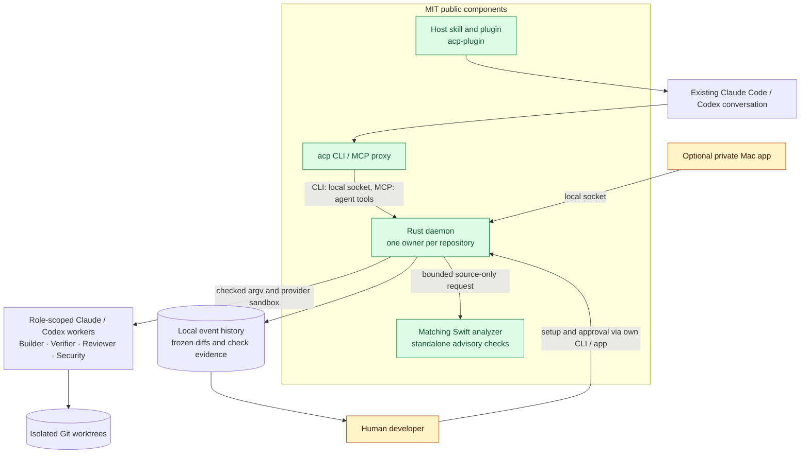

# ACP Core

**A local agent control plane for work you can inspect and approve.** Keep your existing Claude Code
or Codex conversation as the lead. ACP coordinates role-scoped workers, isolated Git worktrees,
selected checks, recorded evidence, recovery and human integration decisions.

**MIT licensed:** Rust CLI/daemon, MCP/socket interfaces, roles, schemas, tests and the matching
Swift Review analyzer. The optional Mac app is developed separately and remains private. It is
not required to install, build or use this core. Provider access comes from your own accounts.

[Install](docs/INSTALLATION.md) · [Host skill](https://github.com/Vvlladd/acp-plugin) ·
[Architecture](#architecture) · [Contribute](CONTRIBUTING.md) · [Security](SECURITY.md) ·
[Roadmap](ROADMAP.md) · [MIT license](LICENSE)

## Install

Most users should install the compiled CLI/helper and the free host plugin using the
[installation guide](https://github.com/Vvlladd/acp-plugin/blob/main/docs/INSTALLATION.md).
No Rust compiler or Mac app is needed for the binary route. Apple Silicon/macOS 26+ is the initial
preview target; local verification is on macOS 27. Downloads are currently ad hoc signed,
**not Developer ID signed or notarized**. Clean-machine and full fresh-host acceptance remain open.

Contributors with Rust 1.94+ and Xcode 27 can build both executables from this repository:

```sh
git clone https://github.com/Vvlladd/acp-core.git
cd acp-core
bash scripts/install-source.sh
```

The script prints the exact PATH command for its new install directory. It does not overwrite an
existing runtime, edit shell profiles, start a daemon or install a host plugin. Then follow the
[skill installation steps](https://github.com/Vvlladd/acp-plugin/blob/main/docs/INSTALLATION.md#2-install-the-skill-in-your-preferred-host)
and run `acp doctor --repo /absolute/path/to/your/repository` before delegating.

## What is implemented

- Build with isolated workers and selected verifier/reviewer/security checks.
- Audit an explicitly selected source snapshot without a builder or integration.
- Record execution choices, attempts, evidence and recoverable history locally.
- Freeze review evidence and require a human decision before the control plane commits.
- Run standalone advisory Swift Review using the bundled, locally sandboxed analyzer.

An existing host conversation stays the lead. Switching its model is the host's responsibility.
The daemon has a closed provider/model catalog; MCP support does not imply compatibility with
arbitrary providers or models. Automatic Swift checks in builder workflows and the proposed
codebase decision-memory product are future work, not features of this preview.

## Architecture

### HLD — clients, runtime and authority



### LLD — execution and evidence

```mermaid
sequenceDiagram
    autonumber
    actor Human
    participant Lead as Host and skill / MCP
    participant Entry as CLI or MCP boundary
    participant Actor as Core actor and policy
    participant Supervisor as Checked process supervisor
    participant Git as Isolated worktree
    participant History as Durable events and frozen evidence
    Human->>Lead: Task, reuse saved team or confirm exact setup
    Lead->>Entry: Submit bounded work
    Entry->>Actor: Validate role, caller scope and execution settings
    Actor->>History: Record run and selected checks
    Actor->>Git: Prepare isolated builder worktree
    Actor->>Supervisor: Launch builder with checked argv
    Supervisor->>Git: Builder edits, workers never commit
    Supervisor-->>Actor: Schema-validated result
    Actor->>Supervisor: Run selected checks on this attempt
    alt Repair required and allowed
        Actor->>Supervisor: Repair and repeat selected checks
    else Ready for human decision
        Actor->>History: Freeze exact diff, attempt and check evidence
        Actor-->>Lead: Pending gate
        Lead-->>Human: Present evidence and wait
        Human->>Entry: Approve using human CLI / socket client
        Entry->>Actor: Socket-only gate approval
        Actor->>Git: Recheck approved bytes under worktree lock, commit
        Actor->>History: Record resulting commit
    end
    Note over Lead,Actor: MCP cannot approve integration. Same-user shell access is not a physical-human boundary.
```

### Source map

| Responsibility | Source |
|---|---|
| CLI and setup | `src/cli.rs`, `src/cli_entry.rs`, `src/cli_app.rs` |
| Agent MCP and human socket doors | `src/mcp/`, `src/ipc/` |
| Policy, teams, loop, gates and history | `src/core/` |
| Checked process launch and recovery | `src/core/supervisor.rs`, `src/core/recovery.rs` |
| Git isolation and immutable snapshots | `src/workspace/` |
| Provider-specific adapters | `src/providers/` |
| Embedded catalog, prompts and schemas | `roles/`, `schemas/` |
| Advisory Swift analysis | `src/checks/`, `tools/acp-swift-checks/` |
| Fake-provider tests and fixtures | `tests/`, `fixtures/`, `src/bin/` |

## Development

```sh
cargo test --locked
cargo clippy --locked --all-targets -- -D warnings
swift test --package-path tools/acp-swift-checks --force-resolved-versions
```

Tests use fake providers by default. Real-provider probes stay ignored and require explicit human
authorization; ordinary contributions must not run them. Local sockets, Git and process inspection
must work in the test environment. Read [CONTRIBUTING.md](CONTRIBUTING.md) for the trust boundaries.
Historical design references in code comments refer to internal development records that are not
part of this fresh public history; public behavior is described here and in [the protocol guide](docs/PROTOCOL.md).

## License and dependencies

ACP code in this repository is [MIT](LICENSE), including the original Swift analyzer. Dependencies
retain their own licenses: see [third-party guidance](THIRD-PARTY-NOTICES.md). Binary distributions
include dependency notices. The license does not cover the separately maintained private Mac app.
